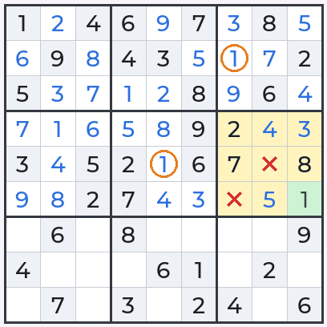

<!-- Written by tools/walkthrough.py diagonal-non-consecutive: edit the script, not this page. -->
# Diagonal Non-Consecutive, step 30: the 1 in box 6

**Step 30 of 47** · [← Step 29](step-29.md) · [All steps](../diagonal-non-consecutive.md#the-whole-puzzle-step-by-step) · [Step 31 →](step-31.md)

Box 6 needs a 1. r5c8: row 5 has one (r5c5). r6c7: column 7 has one (r2c7). Only **r6c9** is left: **r6c9 = 1**.

**Step 30 of 47** · [← Step 29](step-29.md) · [All steps](../diagonal-non-consecutive.md#the-whole-puzzle-step-by-step) · [Step 31 →](step-31.md)
