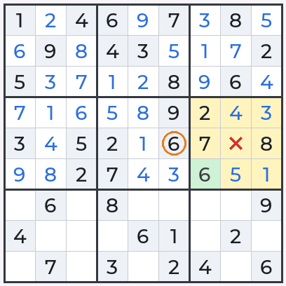

<!-- Written by tools/walkthrough.py diagonal-non-consecutive: edit the script, not this page. -->
# Diagonal Non-Consecutive, step 31: the 6 in box 6

**Step 31 of 47** · [← Step 30](step-30.md) · [All steps](../diagonal-non-consecutive.md#the-whole-puzzle-step-by-step) · [Step 32 →](step-32.md)

Box 6 needs a 6. r5c8: row 5 has one (r5c6). Only **r6c7** is left: **r6c7 = 6**.

**Step 31 of 47** · [← Step 30](step-30.md) · [All steps](../diagonal-non-consecutive.md#the-whole-puzzle-step-by-step) · [Step 32 →](step-32.md)
