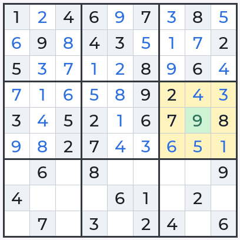

<!-- Written by tools/walkthrough.py diagonal-non-consecutive: edit the script, not this page. -->
# Diagonal Non-Consecutive, step 32: the 9 in box 6

**Step 32 of 47** · [← Step 31](step-31.md) · [All steps](../diagonal-non-consecutive.md#the-whole-puzzle-step-by-step) · [Step 33 →](step-33.md)

Box 6 needs a 9, and r5c8 is its last empty cell: **r5c8 = 9**.

**Step 32 of 47** · [← Step 31](step-31.md) · [All steps](../diagonal-non-consecutive.md#the-whole-puzzle-step-by-step) · [Step 33 →](step-33.md)
