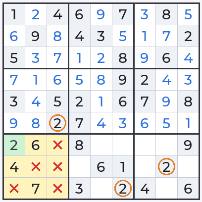

<!-- Written by tools/walkthrough.py diagonal-non-consecutive: edit the script, not this page. -->
# Diagonal Non-Consecutive, step 33: the 2 in box 7

**Step 33 of 47** · [← Step 32](step-32.md) · [All steps](../diagonal-non-consecutive.md#the-whole-puzzle-step-by-step) · [Step 34 →](step-34.md)

Box 7 needs a 2. r7c3: column 3 has one (r6c3). r8c2 and r8c3: row 8 has one (r8c8). r9c1 and r9c3: row 9 has one (r9c6). Only **r7c1** is left: **r7c1 = 2**.

**Step 33 of 47** · [← Step 32](step-32.md) · [All steps](../diagonal-non-consecutive.md#the-whole-puzzle-step-by-step) · [Step 34 →](step-34.md)
