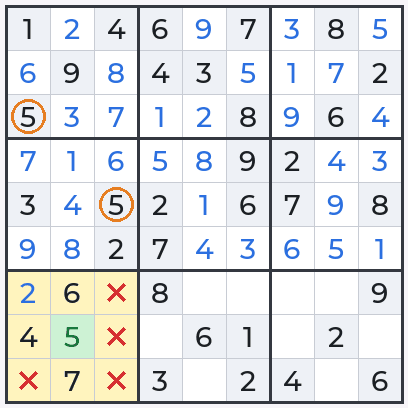

<!-- Written by tools/walkthrough.py diagonal-non-consecutive: edit the script, not this page. -->
# Diagonal Non-Consecutive, step 34: the 5 in box 7

**Step 34 of 47** · [← Step 33](step-33.md) · [All steps](../diagonal-non-consecutive.md#the-whole-puzzle-step-by-step) · [Step 35 →](step-35.md)

Box 7 needs a 5. r7c3, r8c3 and r9c3: column 3 has one (r5c3). r9c1: column 1 has one (r3c1). Only **r8c2** is left: **r8c2 = 5**.

**Step 34 of 47** · [← Step 33](step-33.md) · [All steps](../diagonal-non-consecutive.md#the-whole-puzzle-step-by-step) · [Step 35 →](step-35.md)
