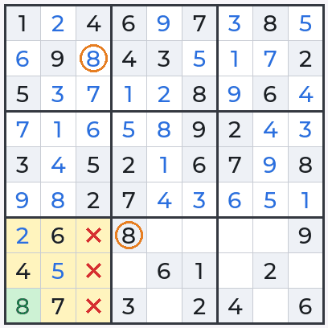

<!-- Written by tools/walkthrough.py diagonal-non-consecutive: edit the script, not this page. -->
# Diagonal Non-Consecutive, step 35: the 8 in box 7

**Step 35 of 47** · [← Step 34](step-34.md) · [All steps](../diagonal-non-consecutive.md#the-whole-puzzle-step-by-step) · [Step 36 →](step-36.md)

Box 7 needs an 8. r7c3: row 7 has one (r7c4). r8c3 and r9c3: column 3 has one (r2c3). Only **r9c1** is left: **r9c1 = 8**.

**Step 35 of 47** · [← Step 34](step-34.md) · [All steps](../diagonal-non-consecutive.md#the-whole-puzzle-step-by-step) · [Step 36 →](step-36.md)
