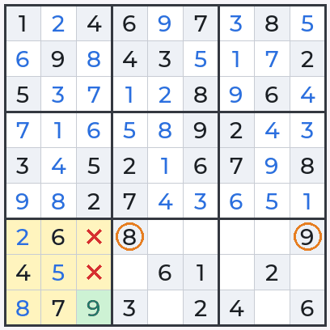

<!-- Written by tools/walkthrough.py diagonal-non-consecutive: edit the script, not this page. -->
# Diagonal Non-Consecutive, step 36: the 9 in box 7

**Step 36 of 47** · [← Step 35](step-35.md) · [All steps](../diagonal-non-consecutive.md#the-whole-puzzle-step-by-step) · [Step 37 →](step-37.md)

Box 7 needs a 9. r7c3: row 7 has one (r7c9). r8c3: it touches the 8 in r7c4 at a corner, and 9 is 1 away from it. Only **r9c3** is left: **r9c3 = 9**.

**Step 36 of 47** · [← Step 35](step-35.md) · [All steps](../diagonal-non-consecutive.md#the-whole-puzzle-step-by-step) · [Step 37 →](step-37.md)
