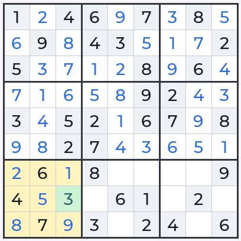

<!-- Written by tools/walkthrough.py diagonal-non-consecutive: edit the script, not this page. -->
# Diagonal Non-Consecutive, step 38: the 3 in box 7

**Step 38 of 47** · [← Step 37](step-37.md) · [All steps](../diagonal-non-consecutive.md#the-whole-puzzle-step-by-step) · [Step 39 →](step-39.md)

Box 7 needs a 3, and r8c3 is its last empty cell: **r8c3 = 3**.

**Step 38 of 47** · [← Step 37](step-37.md) · [All steps](../diagonal-non-consecutive.md#the-whole-puzzle-step-by-step) · [Step 39 →](step-39.md)
