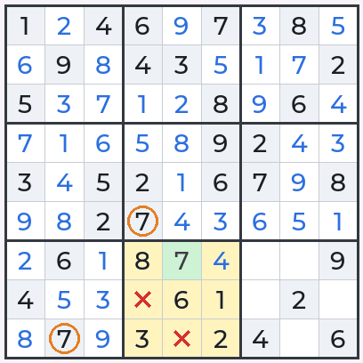

<!-- Written by tools/walkthrough.py diagonal-non-consecutive: edit the script, not this page. -->
# Diagonal Non-Consecutive, step 40: the 7 in box 8

**Step 40 of 47** · [← Step 39](step-39.md) · [All steps](../diagonal-non-consecutive.md#the-whole-puzzle-step-by-step) · [Step 41 →](step-41.md)

Box 8 needs a 7. r8c4: column 4 has one (r6c4). r9c5: row 9 has one (r9c2). Only **r7c5** is left: **r7c5 = 7**.

**Step 40 of 47** · [← Step 39](step-39.md) · [All steps](../diagonal-non-consecutive.md#the-whole-puzzle-step-by-step) · [Step 41 →](step-41.md)
