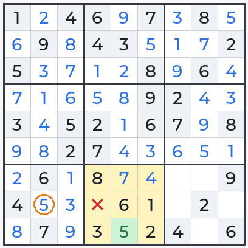

<!-- Written by tools/walkthrough.py diagonal-non-consecutive: edit the script, not this page. -->
# Diagonal Non-Consecutive, step 41: the 5 in box 8

**Step 41 of 47** · [← Step 40](step-40.md) · [All steps](../diagonal-non-consecutive.md#the-whole-puzzle-step-by-step) · [Step 42 →](step-42.md)

Box 8 needs a 5. r8c4: row 8 has one (r8c2). Only **r9c5** is left: **r9c5 = 5**.

**Step 41 of 47** · [← Step 40](step-40.md) · [All steps](../diagonal-non-consecutive.md#the-whole-puzzle-step-by-step) · [Step 42 →](step-42.md)
