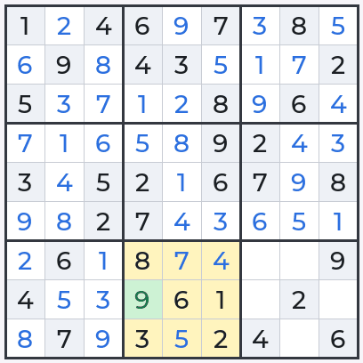

<!-- Written by tools/walkthrough.py diagonal-non-consecutive: edit the script, not this page. -->
# Diagonal Non-Consecutive, step 42: the 9 in box 8

**Step 42 of 47** · [← Step 41](step-41.md) · [All steps](../diagonal-non-consecutive.md#the-whole-puzzle-step-by-step) · [Step 43 →](step-43.md)

Box 8 needs a 9, and r8c4 is its last empty cell: **r8c4 = 9**.

**Step 42 of 47** · [← Step 41](step-41.md) · [All steps](../diagonal-non-consecutive.md#the-whole-puzzle-step-by-step) · [Step 43 →](step-43.md)
