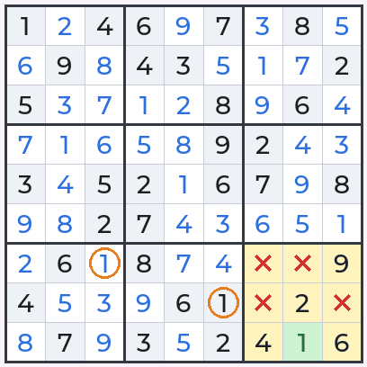

<!-- Written by tools/walkthrough.py diagonal-non-consecutive: edit the script, not this page. -->
# Diagonal Non-Consecutive, step 43: the 1 in box 9

**Step 43 of 47** · [← Step 42](step-42.md) · [All steps](../diagonal-non-consecutive.md#the-whole-puzzle-step-by-step) · [Step 44 →](step-44.md)

Box 9 needs a 1. r7c7 and r7c8: row 7 has one (r7c3). r8c7 and r8c9: row 8 has one (r8c6). Only **r9c8** is left: **r9c8 = 1**.

**Step 43 of 47** · [← Step 42](step-42.md) · [All steps](../diagonal-non-consecutive.md#the-whole-puzzle-step-by-step) · [Step 44 →](step-44.md)
