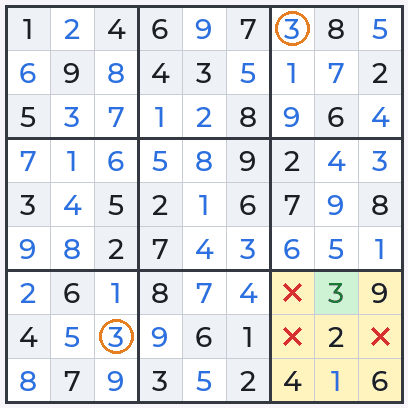

<!-- Written by tools/walkthrough.py diagonal-non-consecutive: edit the script, not this page. -->
# Diagonal Non-Consecutive, step 44: the 3 in box 9

**Step 44 of 47** · [← Step 43](step-43.md) · [All steps](../diagonal-non-consecutive.md#the-whole-puzzle-step-by-step) · [Step 45 →](step-45.md)

Box 9 needs a 3. r7c7: column 7 has one (r1c7). r8c7 and r8c9: row 8 has one (r8c3). Only **r7c8** is left: **r7c8 = 3**.

**Step 44 of 47** · [← Step 43](step-43.md) · [All steps](../diagonal-non-consecutive.md#the-whole-puzzle-step-by-step) · [Step 45 →](step-45.md)
