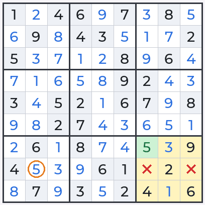

<!-- Written by tools/walkthrough.py diagonal-non-consecutive: edit the script, not this page. -->
# Diagonal Non-Consecutive, step 45: the 5 in box 9

**Step 45 of 47** · [← Step 44](step-44.md) · [All steps](../diagonal-non-consecutive.md#the-whole-puzzle-step-by-step) · [Step 46 →](step-46.md)

Box 9 needs a 5. r8c7 and r8c9: row 8 has one (r8c2). Only **r7c7** is left: **r7c7 = 5**.

**Step 45 of 47** · [← Step 44](step-44.md) · [All steps](../diagonal-non-consecutive.md#the-whole-puzzle-step-by-step) · [Step 46 →](step-46.md)
