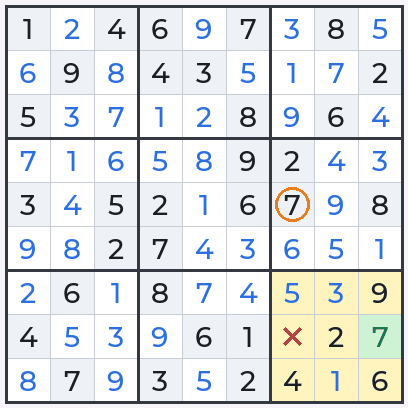

<!-- Written by tools/walkthrough.py diagonal-non-consecutive: edit the script, not this page. -->
# Diagonal Non-Consecutive, step 46: the 7 in box 9

**Step 46 of 47** · [← Step 45](step-45.md) · [All steps](../diagonal-non-consecutive.md#the-whole-puzzle-step-by-step) · [Step 47 →](step-47.md)

Box 9 needs a 7. r8c7: column 7 has one (r5c7). Only **r8c9** is left: **r8c9 = 7**.

**Step 46 of 47** · [← Step 45](step-45.md) · [All steps](../diagonal-non-consecutive.md#the-whole-puzzle-step-by-step) · [Step 47 →](step-47.md)
