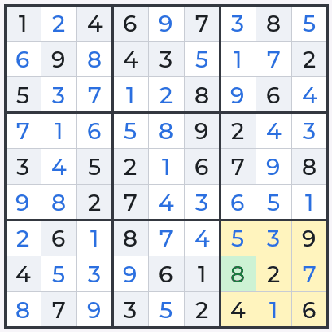

<!-- Written by tools/walkthrough.py diagonal-non-consecutive: edit the script, not this page. -->
# Diagonal Non-Consecutive, step 47: the 8 in box 9

**Step 47 of 47** · [← Step 46](step-46.md) · [All steps](../diagonal-non-consecutive.md#the-whole-puzzle-step-by-step) · [All steps](../diagonal-non-consecutive.md#the-whole-puzzle-step-by-step)

Box 9 needs an 8, and r8c7 is its last empty cell: **r8c7 = 8**.

Solved.

**Step 47 of 47** · [← Step 46](step-46.md) · [All steps](../diagonal-non-consecutive.md#the-whole-puzzle-step-by-step) · [All steps](../diagonal-non-consecutive.md#the-whole-puzzle-step-by-step)
