# Disjoint Groups

[← All variants](README.md) · [Puzzles](../features-puzzles.md) · [How to play](../how-to-play.md)


## The rules

[Classic](classic.md) rules, and the nine cells **in the same place in each 3×3 box** also hold 1 to 9, each once: the nine top-left corners of the boxes, the nine centres, the nine bottom-right corners, and so on. That's nine more groups of nine cells, spread out over the whole grid.

## On the board

- The groups aren't drawn (they'd cover the board); selecting a cell highlights its group along with its row, column and box.
- A repeat within a group turns red; hints name the groups by their place in the box: "Look at the centre cells of the boxes".
- The rules card shows two boxes with the same place tinted in each.
- **Puzzles → ⋮ → New puzzle → Disjoint Groups**.

## How to solve it

- **Find a cell's group:** its place inside its box. Row 5 is the middle row of its box and column 6 the right column, so r5c6 is in the "middle-right" group with r2c3, r2c6, r2c9, r5c3, r5c9, r8c3, r8c6 and r8c9: the same row-in-box and column-in-box everywhere.
- Each cell now has 24 neighbours instead of 20 (four of its group are new; the others already share its row or column), so naked singles come sooner.
- A group is like a tenth "box" scattered over the grid: a hidden single can be in a group too.

## Worked example

**variant-examples #15**, Disjoint Groups Easy (see [Classic](classic.md#worked-example) for how to import the examples; cells are written r*row*c*column*).

```
. 4 . | . 7 . | . 6 .
. 9 5 | 8 . . | 7 . 1
7 6 8 | 1 . 4 | . . .
------+-------+------
9 1 . | . . 7 | . . .
. . . | . 6 . | . . .
. . . | 3 . . | . 9 6
------+-------+------
. . . | 7 . 3 | 8 5 4
4 . 9 | . . 8 | 6 1 .
. 5 . | . 4 . | . 7 .
```

**Step 1: r5c6, in the middle-right group.** Row 5 has a 6; column 6 has 4, 7, 3 and 8; box 5 has 7, 6 and 3. By the Classic rules r5c6 could be 1, 2, 5 or 9. Its group (the middle-right cell of every box: r2c3, r2c6, r2c9, r5c3, r5c9, r8c3, r8c6, r8c9) has a 5 (r2c3), a 1 (r2c9) and a 9 (r8c3). **r5c6 = 2**.

**Step 2: r4c5, in the top-middle group.** Row 4 has 9, 1 and 7; column 5 has 7, 6 and 4; box 5 has 7, 6, 3 and the new 2. That leaves 5 and 8. Its group (the top-middle cell of every box: r1c2, r1c5, r1c8, r4c2, r4c8, r7c2, r7c5, r7c8) has a 5 (r7c8). **r4c5 = 8**.

**Step 3: r6c5, in the bottom-middle group.** Row 6 has 3, 9 and 6; column 5 has 7, 6, 4 and the new 8; box 5 has 7, 6, 3, 2 and 8. That leaves 1 and 5. Its group (the bottom-middle cell of every box: r3c2, r3c5, r3c8, r6c2, r6c8, r9c2, r9c5, r9c8) has a 5 (r9c2). **r6c5 = 1**.

Each time the Classic rules got a cell down to a few digits, and a group far away across the grid settled it.

## The whole puzzle, step by step

<!-- walkthrough -->
<!-- Written by tools/walkthrough.py disjoint-groups: edit the script, not this part. -->

The whole puzzle, from the start to the last cell: 48 steps, each one a single (one place left for a digit, or one digit left for a cell), taken in the order a box's single comes first, so not quite the order of the worked example above. In each picture, the unit the step looks at is tinted yellow (for a cell with one digit left: its row, column and box), the new digit is on green, the digits that rule cells out have an **orange ring**, and the empty cells they rule out a **red cross**. Givens are on grey, digits from earlier steps in blue.

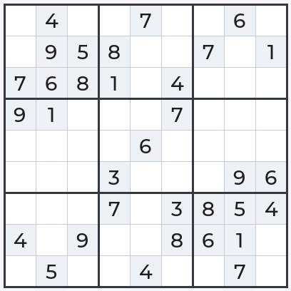

#### Step 1: the 6 in box 2

Box 2 needs a 6. r1c4 and r1c6: row 1 has one (r1c8). r2c5: column 5 has one (r5c5). r3c5: row 3 has one (r3c2). Only **r2c6** is left: **r2c6 = 6**.


#### Step 2: the 9 in box 2

Box 2 needs a 9. r1c4: the top-left group has one (r4c1). r2c5: row 2 has one (r2c2). r3c5: the bottom group has one (r6c8). Only **r1c6** is left: **r1c6 = 9**.

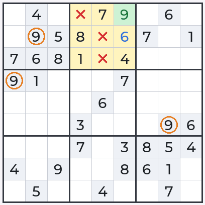

#### Step 3: the 5 in box 2

Box 2 needs a 5. r2c5: row 2 has one (r2c3). r3c5: the bottom group has one (r9c2). Only **r1c4** is left: **r1c4 = 5**.

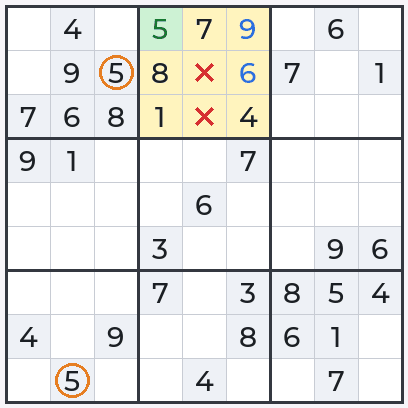

#### Step 4: the 4 in box 3

Box 3 needs a 4. r1c7 and r1c9: row 1 has one (r1c2). r3c7, r3c8 and r3c9: row 3 has one (r3c6). Only **r2c8** is left: **r2c8 = 4**.

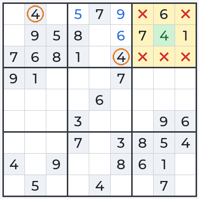

#### Step 5: the 8 in box 3

Box 3 needs an 8. r1c7: column 7 has one (r7c7). r3c7, r3c8 and r3c9: row 3 has one (r3c3). Only **r1c9** is left: **r1c9 = 8**.


#### Step 6: the 4 in box 4

Box 4 needs a 4. r4c3: the top-right group has one (r7c9). r5c1 and r6c1: column 1 has one (r8c1). r5c2 and r6c2: column 2 has one (r1c2). r6c3: the bottom-right group has one (r3c6). Only **r5c3** is left: **r5c3 = 4**.


#### Step 7: the 6 in box 4

Box 4 needs a 6. r5c1 and r5c2: row 5 has one (r5c5). r6c1, r6c2 and r6c3: row 6 has one (r6c9). Only **r4c3** is left: **r4c3 = 6**.


#### Step 8: the 4 in box 5

Box 5 needs a 4. r4c5 and r6c5: column 5 has one (r9c5). r5c4 and r5c6: row 5 has one (r5c3). r6c6: column 6 has one (r3c6). Only **r4c4** is left: **r4c4 = 4**.


#### Step 9: the 5 in box 5

Box 5 needs a 5. r4c5: the top group has one (r7c8). r5c4: column 4 has one (r1c4). r5c6: the right group has one (r2c3). r6c5: the bottom group has one (r9c2). Only **r6c6** is left: **r6c6 = 5**.


#### Step 10: the 5 in box 3

Box 3 needs a 5. r1c7: row 1 has one (r1c4). r3c8: column 8 has one (r7c8). r3c9: the bottom-right group has one (r6c6). Only **r3c7** is left: **r3c7 = 5**.


#### Step 11: the 9 in box 3

Box 3 needs a 9. r1c7: row 1 has one (r1c6). r3c8: column 8 has one (r6c8). Only **r3c9** is left: **r3c9 = 9**.


#### Step 12: the 5 in box 4

Box 4 needs a 5. r5c2: column 2 has one (r9c2). r6c1, r6c2 and r6c3: row 6 has one (r6c6). Only **r5c1** is left: **r5c1 = 5**.


#### Step 13: the 3 in box 4

Box 4 needs a 3. r6c1, r6c2 and r6c3: row 6 has one (r6c4). Only **r5c2** is left: **r5c2 = 3**.

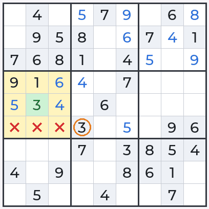

#### Step 14: the 3 in box 2

Box 2 needs a 3. r2c5: the centre group has one (r5c2). Only **r3c5** is left: **r3c5 = 3**.

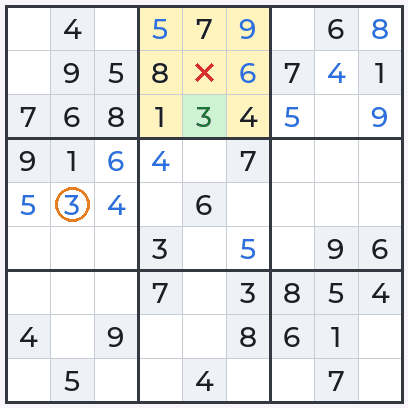

#### Step 15: the 2 in box 2

Box 2 needs a 2, and r2c5 is its last empty cell: **r2c5 = 2**.

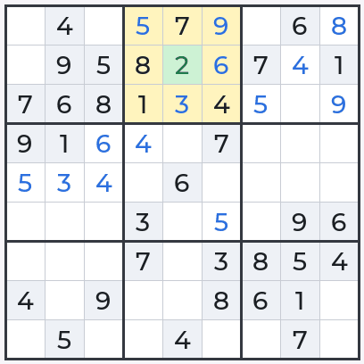

#### Step 16: the 3 in box 3

Box 3 needs a 3. r3c8: row 3 has one (r3c5). Only **r1c7** is left: **r1c7 = 3**.

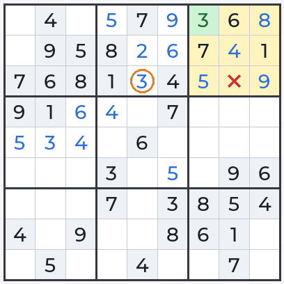

#### Step 17: the 3 in box 1

Box 1 needs a 3. r1c1 and r1c3: row 1 has one (r1c7). Only **r2c1** is left: **r2c1 = 3**.

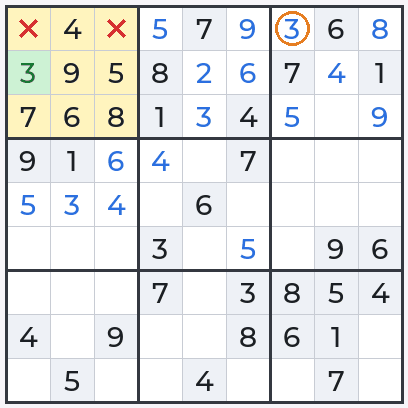

#### Step 18: the 2 in box 3

Box 3 needs a 2, and r3c8 is its last empty cell: **r3c8 = 2**.


#### Step 19: the 7 in box 4

Box 4 needs a 7. r6c1: column 1 has one (r3c1). r6c2: the bottom group has one (r9c8). Only **r6c3** is left: **r6c3 = 7**.

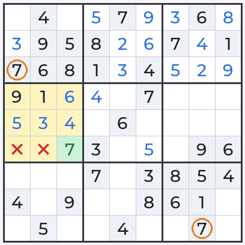

#### Step 20: the 2 in box 4

Box 4 needs a 2. r6c2: the bottom group has one (r3c8). Only **r6c1** is left: **r6c1 = 2**.

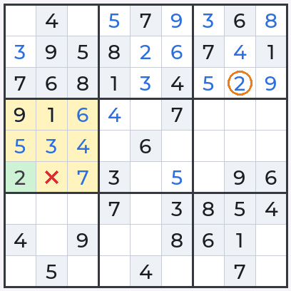

#### Step 21: the 2 in box 1

Box 1 needs a 2. r1c1: column 1 has one (r6c1). Only **r1c3** is left: **r1c3 = 2**.


#### Step 22: the 1 in box 1

Box 1 needs a 1, and r1c1 is its last empty cell: **r1c1 = 1**.

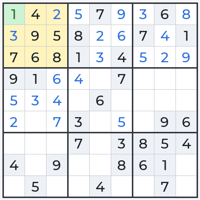

#### Step 23: the 8 in box 4

Box 4 needs an 8, and r6c2 is its last empty cell: **r6c2 = 8**.


#### Step 24: the 1 in box 5

Box 5 needs a 1. r4c5: row 4 has one (r4c2). r5c4: column 4 has one (r3c4). r5c6: the right group has one (r2c9). Only **r6c5** is left: **r6c5 = 1**.


#### Step 25: the 8 in box 5

Box 5 needs an 8. r5c4: column 4 has one (r2c4). r5c6: column 6 has one (r8c6). Only **r4c5** is left: **r4c5 = 8**.

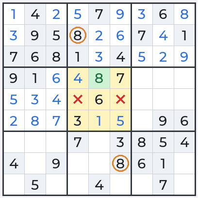

#### Step 26: the 9 in box 5

Box 5 needs a 9. r5c6: column 6 has one (r1c6). Only **r5c4** is left: **r5c4 = 9**.


#### Step 27: the 2 in box 5

Box 5 needs a 2, and r5c6 is its last empty cell: **r5c6 = 2**.


#### Step 28: the 1 in box 6

Box 6 needs a 1. r4c7, r4c8 and r4c9: row 4 has one (r4c2). r5c8: column 8 has one (r8c8). r5c9: column 9 has one (r2c9). r6c7: row 6 has one (r6c5). Only **r5c7** is left: **r5c7 = 1**.

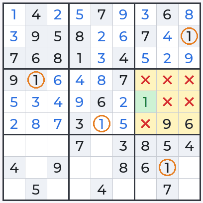

#### Step 29: the 2 in box 6

Box 6 needs a 2. r4c8: column 8 has one (r3c8). r4c9: the top-right group has one (r1c3). r5c8 and r5c9: row 5 has one (r5c6). r6c7: row 6 has one (r6c1). Only **r4c7** is left: **r4c7 = 2**.


#### Step 30: the 3 in box 6

Box 6 needs a 3. r4c9: the top-right group has one (r7c6). r5c8 and r5c9: row 5 has one (r5c2). r6c7: row 6 has one (r6c4). Only **r4c8** is left: **r4c8 = 3**.


#### Step 31: the 4 in box 6

Box 6 needs a 4. r4c9: row 4 has one (r4c4). r5c8 and r5c9: row 5 has one (r5c3). Only **r6c7** is left: **r6c7 = 4**.


#### Step 32: the 5 in box 6

Box 6 needs a 5. r5c8 and r5c9: row 5 has one (r5c1). Only **r4c9** is left: **r4c9 = 5**.


#### Step 33: the 7 in box 6

Box 6 needs a 7. r5c8: column 8 has one (r9c8). Only **r5c9** is left: **r5c9 = 7**.

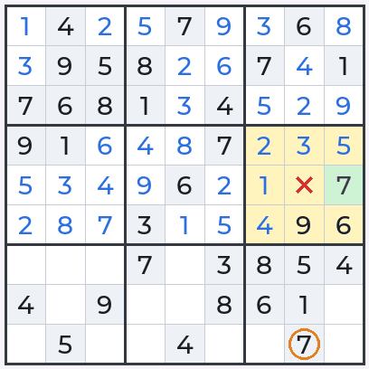

#### Step 34: the 8 in box 6

Box 6 needs an 8, and r5c8 is its last empty cell: **r5c8 = 8**.

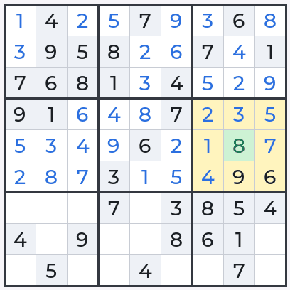

#### Step 35: the 2 in box 7

Box 7 needs a 2. r7c1 and r9c1: column 1 has one (r6c1). r7c3 and r9c3: column 3 has one (r1c3). r8c2: the centre group has one (r2c5). Only **r7c2** is left: **r7c2 = 2**.

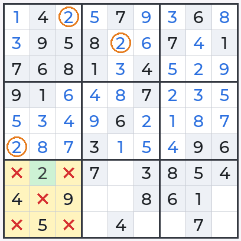

#### Step 36: the 3 in box 7

Box 7 needs a 3. r7c1 and r7c3: row 7 has one (r7c6). r8c2: column 2 has one (r5c2). r9c1: column 1 has one (r2c1). Only **r9c3** is left: **r9c3 = 3**.


#### Step 37: the 1 in box 7

Box 7 needs a 1. r7c1 and r9c1: column 1 has one (r1c1). r8c2: row 8 has one (r8c8). Only **r7c3** is left: **r7c3 = 1**.

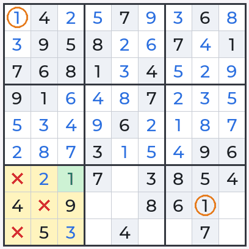

#### Step 38: the 7 in box 7

Box 7 needs a 7. r7c1: row 7 has one (r7c4). r9c1: row 9 has one (r9c8). Only **r8c2** is left: **r8c2 = 7**.


#### Step 39: the 8 in box 7

Box 7 needs an 8. r7c1: row 7 has one (r7c7). Only **r9c1** is left: **r9c1 = 8**.

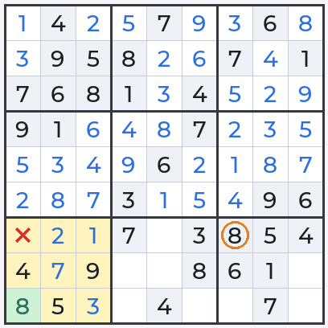

#### Step 40: the 6 in box 7

Box 7 needs a 6, and r7c1 is its last empty cell: **r7c1 = 6**.


#### Step 41: the 1 in box 8

Box 8 needs a 1. r7c5: row 7 has one (r7c3). r8c4 and r8c5: row 8 has one (r8c8). r9c4: column 4 has one (r3c4). Only **r9c6** is left: **r9c6 = 1**.

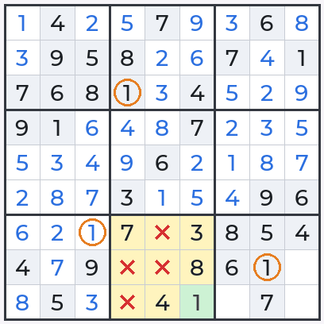

#### Step 42: the 2 in box 8

Box 8 needs a 2. r7c5: row 7 has one (r7c2). r8c5: column 5 has one (r2c5). r9c4: the bottom-left group has one (r6c1). Only **r8c4** is left: **r8c4 = 2**.

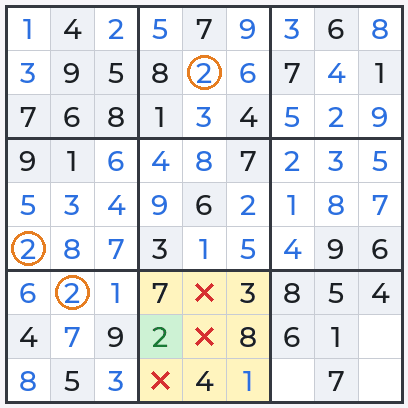

#### Step 43: the 5 in box 8

Box 8 needs a 5. r7c5: row 7 has one (r7c8). r9c4: row 9 has one (r9c2). Only **r8c5** is left: **r8c5 = 5**.

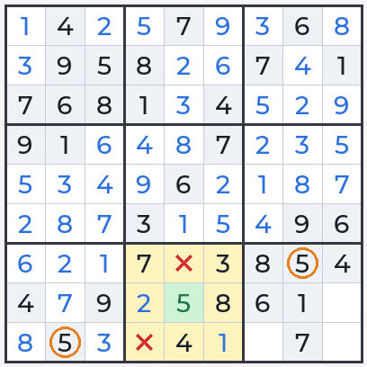

#### Step 44: the 6 in box 8

Box 8 needs a 6. r7c5: row 7 has one (r7c1). Only **r9c4** is left: **r9c4 = 6**.


#### Step 45: the 9 in box 8

Box 8 needs a 9, and r7c5 is its last empty cell: **r7c5 = 9**.


#### Step 46: the 2 in box 9

Box 9 needs a 2. r8c9: row 8 has one (r8c4). r9c7: column 7 has one (r4c7). Only **r9c9** is left: **r9c9 = 2**.

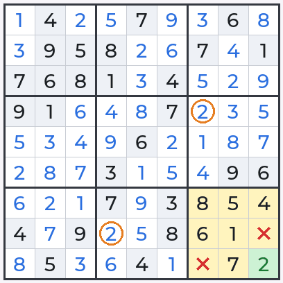

#### Step 47: the 3 in box 9

Box 9 needs a 3. r9c7: row 9 has one (r9c3). Only **r8c9** is left: **r8c9 = 3**.

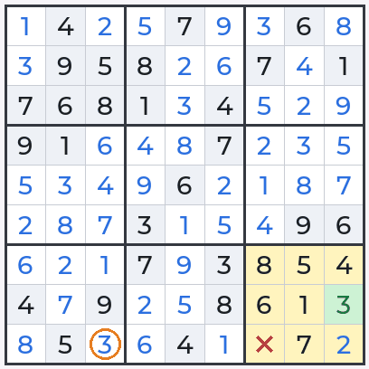

#### Step 48: the 9 in box 9

Box 9 needs a 9, and r9c7 is its last empty cell: **r9c7 = 9**.


Solved.

<!-- /walkthrough -->
