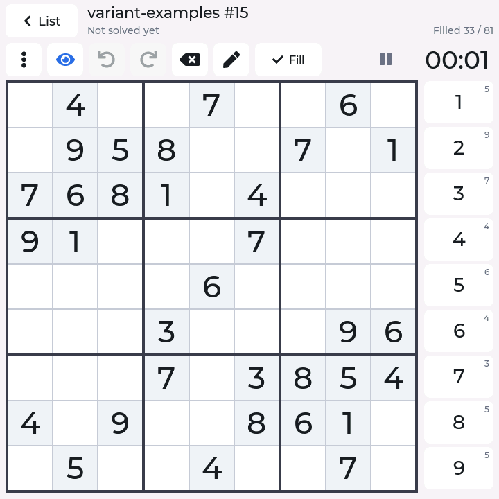

# Disjoint Groups

[← All variants](README.md) · [Puzzles](../features-puzzles.md) · [How to play](../how-to-play.md)



## The rules

[Classic](classic.md) rules, and the nine cells **in the same place in each 3×3 box** also hold 1 to 9, each once: the nine top-left corners of the boxes, the nine centres, the nine bottom-right corners, and so on. That's nine more groups of nine cells, spread out over the whole grid.

## On the board

- The groups aren't drawn (they'd cover the board); selecting a cell highlights its group along with its row, column and box.
- A repeat within a group turns red; hints name the groups by their place in the box: "Look at the centre cells of the boxes".
- The rules card shows two boxes with the same place tinted in each.
- **Puzzles → ⋮ → New puzzle → Disjoint Groups**.

## How to solve it

- **Find a cell's group:** its place inside its box. Row 5 is the middle row of its box and column 6 the right column, so r5c6 is in the "middle-right" group with r2c3, r2c6, r2c9, r5c3, r5c9, r8c3, r8c6 and r8c9: the same row-in-box and column-in-box everywhere.
- Each cell now has 24 neighbours instead of 20 (four of its group are new; the others already share its row or column), so naked singles come sooner.
- A group is like a tenth "box" scattered over the grid: a hidden single can be in a group too.

## Worked example

**variant-examples #15**, Disjoint Groups Easy (see [Classic](classic.md#worked-example) for how to import the examples; cells are written r*row*c*column*).

```
. 4 . | . 7 . | . 6 .
. 9 5 | 8 . . | 7 . 1
7 6 8 | 1 . 4 | . . .
------+-------+------
9 1 . | . . 7 | . . .
. . . | . 6 . | . . .
. . . | 3 . . | . 9 6
------+-------+------
. . . | 7 . 3 | 8 5 4
4 . 9 | . . 8 | 6 1 .
. 5 . | . 4 . | . 7 .
```

**Step 1: r5c6, in the middle-right group.** Row 5 has a 6; column 6 has 4, 7, 3 and 8; box 5 has 7, 6 and 3. By the Classic rules r5c6 could be 1, 2, 5 or 9. Its group (the middle-right cell of every box: r2c3, r2c6, r2c9, r5c3, r5c9, r8c3, r8c6, r8c9) has a 5 (r2c3), a 1 (r2c9) and a 9 (r8c3). **r5c6 = 2**.

**Step 2: r4c5, in the top-middle group.** Row 4 has 9, 1 and 7; column 5 has 7, 6 and 4; box 5 has 7, 6, 3 and the new 2. That leaves 5 and 8. Its group (the top-middle cell of every box: r1c2, r1c5, r1c8, r4c2, r4c8, r7c2, r7c5, r7c8) has a 5 (r7c8). **r4c5 = 8**.

**Step 3: r6c5, in the bottom-middle group.** Row 6 has 3, 9 and 6; column 5 has 7, 6, 4 and the new 8; box 5 has 7, 6, 3, 2 and 8. That leaves 1 and 5. Its group (the bottom-middle cell of every box: r3c2, r3c5, r3c8, r6c2, r6c8, r9c2, r9c5, r9c8) has a 5 (r9c2). **r6c5 = 1**.

Each time the Classic rules got a cell down to a few digits, and a group far away across the grid settled it.
