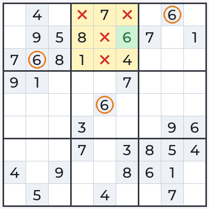

<!-- Written by tools/walkthrough.py disjoint-groups: edit the script, not this page. -->
# Disjoint Groups, step 1: the 6 in box 2

**Step 1 of 48** · [← The start](../disjoint-groups.md#the-whole-puzzle-step-by-step) · [All steps](../disjoint-groups.md#the-whole-puzzle-step-by-step) · [Step 2 →](step-02.md)

Box 2 needs a 6. r1c4 and r1c6: row 1 has one (r1c8). r2c5: column 5 has one (r5c5). r3c5: row 3 has one (r3c2). Only **r2c6** is left: **r2c6 = 6**.

**Step 1 of 48** · [← The start](../disjoint-groups.md#the-whole-puzzle-step-by-step) · [All steps](../disjoint-groups.md#the-whole-puzzle-step-by-step) · [Step 2 →](step-02.md)
