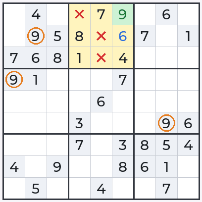

<!-- Written by tools/walkthrough.py disjoint-groups: edit the script, not this page. -->
# Disjoint Groups, step 2: the 9 in box 2

**Step 2 of 48** · [← Step 1](step-01.md) · [All steps](../disjoint-groups.md#the-whole-puzzle-step-by-step) · [Step 3 →](step-03.md)

Box 2 needs a 9. r1c4: the top-left group has one (r4c1). r2c5: row 2 has one (r2c2). r3c5: the bottom group has one (r6c8). Only **r1c6** is left: **r1c6 = 9**.

**Step 2 of 48** · [← Step 1](step-01.md) · [All steps](../disjoint-groups.md#the-whole-puzzle-step-by-step) · [Step 3 →](step-03.md)
