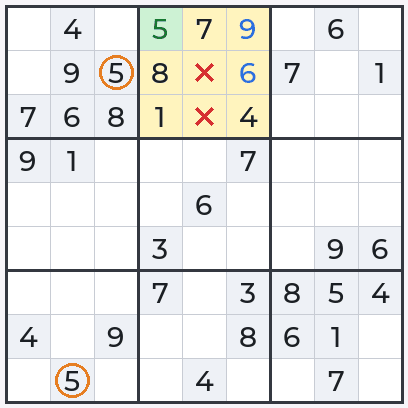

<!-- Written by tools/walkthrough.py disjoint-groups: edit the script, not this page. -->
# Disjoint Groups, step 3: the 5 in box 2

**Step 3 of 48** · [← Step 2](step-02.md) · [All steps](../disjoint-groups.md#the-whole-puzzle-step-by-step) · [Step 4 →](step-04.md)

Box 2 needs a 5. r2c5: row 2 has one (r2c3). r3c5: the bottom group has one (r9c2). Only **r1c4** is left: **r1c4 = 5**.

**Step 3 of 48** · [← Step 2](step-02.md) · [All steps](../disjoint-groups.md#the-whole-puzzle-step-by-step) · [Step 4 →](step-04.md)
