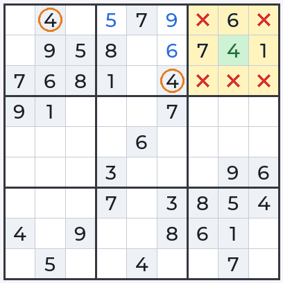

<!-- Written by tools/walkthrough.py disjoint-groups: edit the script, not this page. -->
# Disjoint Groups, step 4: the 4 in box 3

**Step 4 of 48** · [← Step 3](step-03.md) · [All steps](../disjoint-groups.md#the-whole-puzzle-step-by-step) · [Step 5 →](step-05.md)

Box 3 needs a 4. r1c7 and r1c9: row 1 has one (r1c2). r3c7, r3c8 and r3c9: row 3 has one (r3c6). Only **r2c8** is left: **r2c8 = 4**.

**Step 4 of 48** · [← Step 3](step-03.md) · [All steps](../disjoint-groups.md#the-whole-puzzle-step-by-step) · [Step 5 →](step-05.md)
