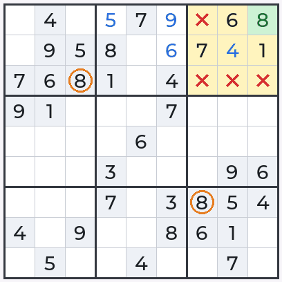

<!-- Written by tools/walkthrough.py disjoint-groups: edit the script, not this page. -->
# Disjoint Groups, step 5: the 8 in box 3

**Step 5 of 48** · [← Step 4](step-04.md) · [All steps](../disjoint-groups.md#the-whole-puzzle-step-by-step) · [Step 6 →](step-06.md)

Box 3 needs an 8. r1c7: column 7 has one (r7c7). r3c7, r3c8 and r3c9: row 3 has one (r3c3). Only **r1c9** is left: **r1c9 = 8**.

**Step 5 of 48** · [← Step 4](step-04.md) · [All steps](../disjoint-groups.md#the-whole-puzzle-step-by-step) · [Step 6 →](step-06.md)
