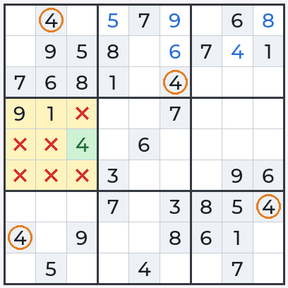

<!-- Written by tools/walkthrough.py disjoint-groups: edit the script, not this page. -->
# Disjoint Groups, step 6: the 4 in box 4

**Step 6 of 48** · [← Step 5](step-05.md) · [All steps](../disjoint-groups.md#the-whole-puzzle-step-by-step) · [Step 7 →](step-07.md)

Box 4 needs a 4. r4c3: the top-right group has one (r7c9). r5c1 and r6c1: column 1 has one (r8c1). r5c2 and r6c2: column 2 has one (r1c2). r6c3: the bottom-right group has one (r3c6). Only **r5c3** is left: **r5c3 = 4**.

**Step 6 of 48** · [← Step 5](step-05.md) · [All steps](../disjoint-groups.md#the-whole-puzzle-step-by-step) · [Step 7 →](step-07.md)
