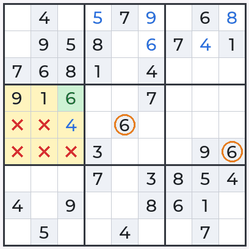

<!-- Written by tools/walkthrough.py disjoint-groups: edit the script, not this page. -->
# Disjoint Groups, step 7: the 6 in box 4

**Step 7 of 48** · [← Step 6](step-06.md) · [All steps](../disjoint-groups.md#the-whole-puzzle-step-by-step) · [Step 8 →](step-08.md)

Box 4 needs a 6. r5c1 and r5c2: row 5 has one (r5c5). r6c1, r6c2 and r6c3: row 6 has one (r6c9). Only **r4c3** is left: **r4c3 = 6**.

**Step 7 of 48** · [← Step 6](step-06.md) · [All steps](../disjoint-groups.md#the-whole-puzzle-step-by-step) · [Step 8 →](step-08.md)
