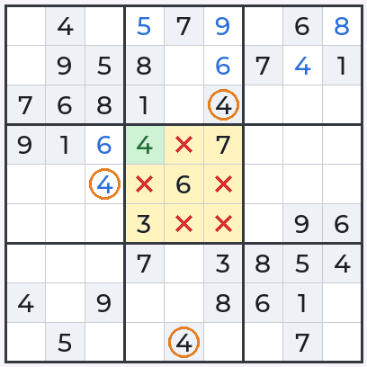

<!-- Written by tools/walkthrough.py disjoint-groups: edit the script, not this page. -->
# Disjoint Groups, step 8: the 4 in box 5

**Step 8 of 48** · [← Step 7](step-07.md) · [All steps](../disjoint-groups.md#the-whole-puzzle-step-by-step) · [Step 9 →](step-09.md)

Box 5 needs a 4. r4c5 and r6c5: column 5 has one (r9c5). r5c4 and r5c6: row 5 has one (r5c3). r6c6: column 6 has one (r3c6). Only **r4c4** is left: **r4c4 = 4**.

**Step 8 of 48** · [← Step 7](step-07.md) · [All steps](../disjoint-groups.md#the-whole-puzzle-step-by-step) · [Step 9 →](step-09.md)
