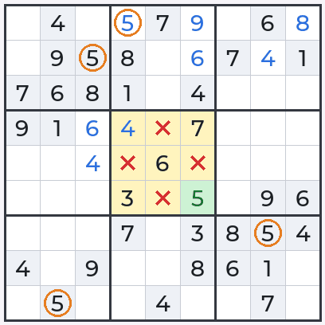

<!-- Written by tools/walkthrough.py disjoint-groups: edit the script, not this page. -->
# Disjoint Groups, step 9: the 5 in box 5

**Step 9 of 48** · [← Step 8](step-08.md) · [All steps](../disjoint-groups.md#the-whole-puzzle-step-by-step) · [Step 10 →](step-10.md)

Box 5 needs a 5. r4c5: the top group has one (r7c8). r5c4: column 4 has one (r1c4). r5c6: the right group has one (r2c3). r6c5: the bottom group has one (r9c2). Only **r6c6** is left: **r6c6 = 5**.

**Step 9 of 48** · [← Step 8](step-08.md) · [All steps](../disjoint-groups.md#the-whole-puzzle-step-by-step) · [Step 10 →](step-10.md)
