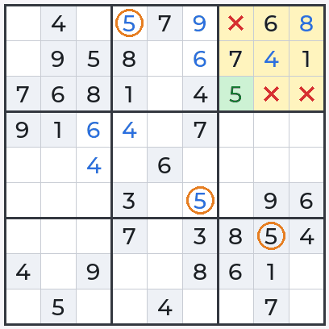

<!-- Written by tools/walkthrough.py disjoint-groups: edit the script, not this page. -->
# Disjoint Groups, step 10: the 5 in box 3

**Step 10 of 48** · [← Step 9](step-09.md) · [All steps](../disjoint-groups.md#the-whole-puzzle-step-by-step) · [Step 11 →](step-11.md)

Box 3 needs a 5. r1c7: row 1 has one (r1c4). r3c8: column 8 has one (r7c8). r3c9: the bottom-right group has one (r6c6). Only **r3c7** is left: **r3c7 = 5**.

**Step 10 of 48** · [← Step 9](step-09.md) · [All steps](../disjoint-groups.md#the-whole-puzzle-step-by-step) · [Step 11 →](step-11.md)
