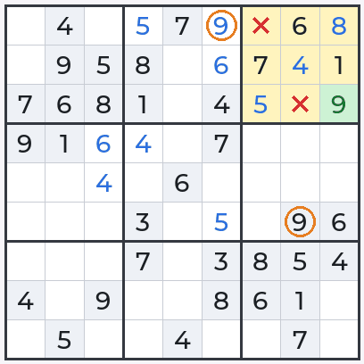

<!-- Written by tools/walkthrough.py disjoint-groups: edit the script, not this page. -->
# Disjoint Groups, step 11: the 9 in box 3

**Step 11 of 48** · [← Step 10](step-10.md) · [All steps](../disjoint-groups.md#the-whole-puzzle-step-by-step) · [Step 12 →](step-12.md)

Box 3 needs a 9. r1c7: row 1 has one (r1c6). r3c8: column 8 has one (r6c8). Only **r3c9** is left: **r3c9 = 9**.

**Step 11 of 48** · [← Step 10](step-10.md) · [All steps](../disjoint-groups.md#the-whole-puzzle-step-by-step) · [Step 12 →](step-12.md)
