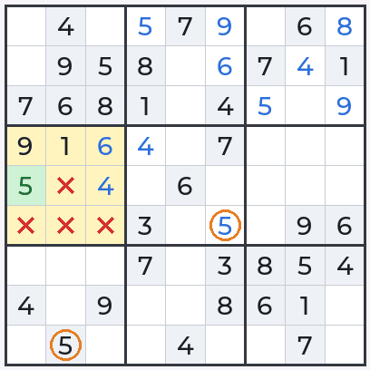

<!-- Written by tools/walkthrough.py disjoint-groups: edit the script, not this page. -->
# Disjoint Groups, step 12: the 5 in box 4

**Step 12 of 48** · [← Step 11](step-11.md) · [All steps](../disjoint-groups.md#the-whole-puzzle-step-by-step) · [Step 13 →](step-13.md)

Box 4 needs a 5. r5c2: column 2 has one (r9c2). r6c1, r6c2 and r6c3: row 6 has one (r6c6). Only **r5c1** is left: **r5c1 = 5**.

**Step 12 of 48** · [← Step 11](step-11.md) · [All steps](../disjoint-groups.md#the-whole-puzzle-step-by-step) · [Step 13 →](step-13.md)
