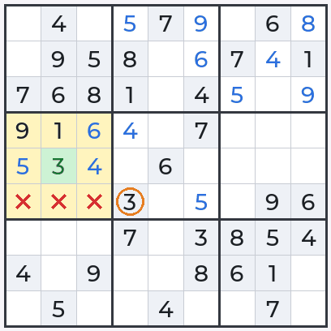

<!-- Written by tools/walkthrough.py disjoint-groups: edit the script, not this page. -->
# Disjoint Groups, step 13: the 3 in box 4

**Step 13 of 48** · [← Step 12](step-12.md) · [All steps](../disjoint-groups.md#the-whole-puzzle-step-by-step) · [Step 14 →](step-14.md)

Box 4 needs a 3. r6c1, r6c2 and r6c3: row 6 has one (r6c4). Only **r5c2** is left: **r5c2 = 3**.

**Step 13 of 48** · [← Step 12](step-12.md) · [All steps](../disjoint-groups.md#the-whole-puzzle-step-by-step) · [Step 14 →](step-14.md)
