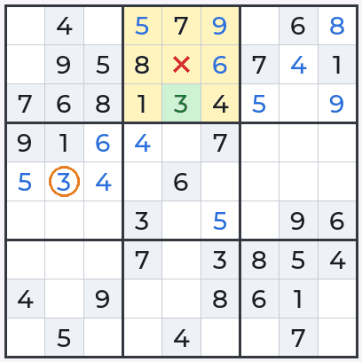

<!-- Written by tools/walkthrough.py disjoint-groups: edit the script, not this page. -->
# Disjoint Groups, step 14: the 3 in box 2

**Step 14 of 48** · [← Step 13](step-13.md) · [All steps](../disjoint-groups.md#the-whole-puzzle-step-by-step) · [Step 15 →](step-15.md)

Box 2 needs a 3. r2c5: the centre group has one (r5c2). Only **r3c5** is left: **r3c5 = 3**.

**Step 14 of 48** · [← Step 13](step-13.md) · [All steps](../disjoint-groups.md#the-whole-puzzle-step-by-step) · [Step 15 →](step-15.md)
