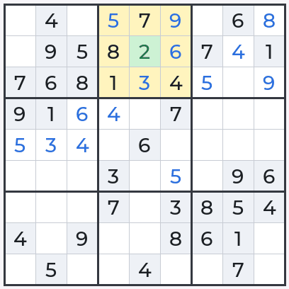

<!-- Written by tools/walkthrough.py disjoint-groups: edit the script, not this page. -->
# Disjoint Groups, step 15: the 2 in box 2

**Step 15 of 48** · [← Step 14](step-14.md) · [All steps](../disjoint-groups.md#the-whole-puzzle-step-by-step) · [Step 16 →](step-16.md)

Box 2 needs a 2, and r2c5 is its last empty cell: **r2c5 = 2**.

**Step 15 of 48** · [← Step 14](step-14.md) · [All steps](../disjoint-groups.md#the-whole-puzzle-step-by-step) · [Step 16 →](step-16.md)
