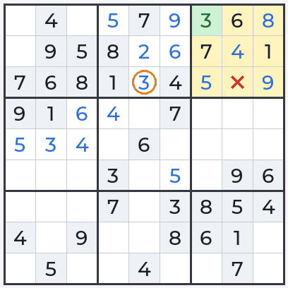

<!-- Written by tools/walkthrough.py disjoint-groups: edit the script, not this page. -->
# Disjoint Groups, step 16: the 3 in box 3

**Step 16 of 48** · [← Step 15](step-15.md) · [All steps](../disjoint-groups.md#the-whole-puzzle-step-by-step) · [Step 17 →](step-17.md)

Box 3 needs a 3. r3c8: row 3 has one (r3c5). Only **r1c7** is left: **r1c7 = 3**.

**Step 16 of 48** · [← Step 15](step-15.md) · [All steps](../disjoint-groups.md#the-whole-puzzle-step-by-step) · [Step 17 →](step-17.md)
