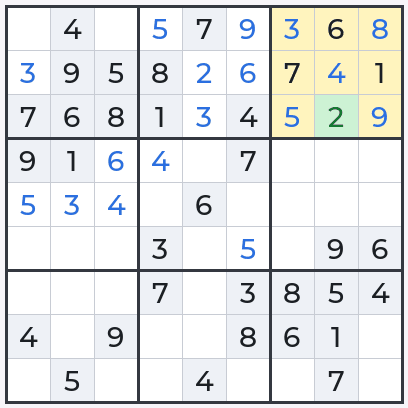

<!-- Written by tools/walkthrough.py disjoint-groups: edit the script, not this page. -->
# Disjoint Groups, step 18: the 2 in box 3

**Step 18 of 48** · [← Step 17](step-17.md) · [All steps](../disjoint-groups.md#the-whole-puzzle-step-by-step) · [Step 19 →](step-19.md)

Box 3 needs a 2, and r3c8 is its last empty cell: **r3c8 = 2**.

**Step 18 of 48** · [← Step 17](step-17.md) · [All steps](../disjoint-groups.md#the-whole-puzzle-step-by-step) · [Step 19 →](step-19.md)
