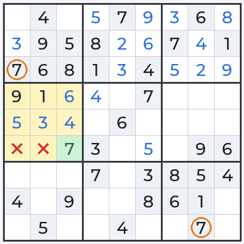

<!-- Written by tools/walkthrough.py disjoint-groups: edit the script, not this page. -->
# Disjoint Groups, step 19: the 7 in box 4

**Step 19 of 48** · [← Step 18](step-18.md) · [All steps](../disjoint-groups.md#the-whole-puzzle-step-by-step) · [Step 20 →](step-20.md)

Box 4 needs a 7. r6c1: column 1 has one (r3c1). r6c2: the bottom group has one (r9c8). Only **r6c3** is left: **r6c3 = 7**.

**Step 19 of 48** · [← Step 18](step-18.md) · [All steps](../disjoint-groups.md#the-whole-puzzle-step-by-step) · [Step 20 →](step-20.md)
