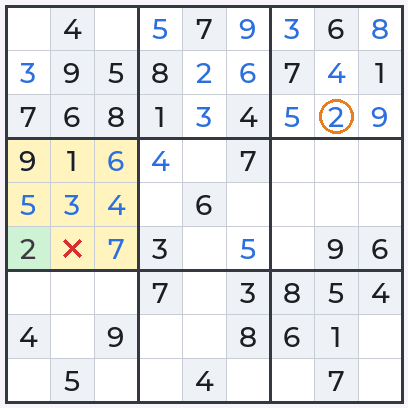

<!-- Written by tools/walkthrough.py disjoint-groups: edit the script, not this page. -->
# Disjoint Groups, step 20: the 2 in box 4

**Step 20 of 48** · [← Step 19](step-19.md) · [All steps](../disjoint-groups.md#the-whole-puzzle-step-by-step) · [Step 21 →](step-21.md)

Box 4 needs a 2. r6c2: the bottom group has one (r3c8). Only **r6c1** is left: **r6c1 = 2**.

**Step 20 of 48** · [← Step 19](step-19.md) · [All steps](../disjoint-groups.md#the-whole-puzzle-step-by-step) · [Step 21 →](step-21.md)
