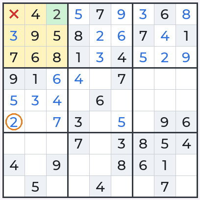

<!-- Written by tools/walkthrough.py disjoint-groups: edit the script, not this page. -->
# Disjoint Groups, step 21: the 2 in box 1

**Step 21 of 48** · [← Step 20](step-20.md) · [All steps](../disjoint-groups.md#the-whole-puzzle-step-by-step) · [Step 22 →](step-22.md)

Box 1 needs a 2. r1c1: column 1 has one (r6c1). Only **r1c3** is left: **r1c3 = 2**.

**Step 21 of 48** · [← Step 20](step-20.md) · [All steps](../disjoint-groups.md#the-whole-puzzle-step-by-step) · [Step 22 →](step-22.md)
