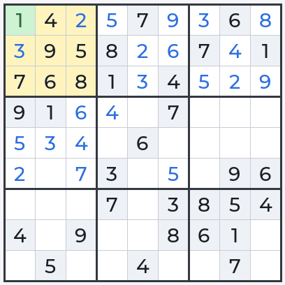

<!-- Written by tools/walkthrough.py disjoint-groups: edit the script, not this page. -->
# Disjoint Groups, step 22: the 1 in box 1

**Step 22 of 48** · [← Step 21](step-21.md) · [All steps](../disjoint-groups.md#the-whole-puzzle-step-by-step) · [Step 23 →](step-23.md)

Box 1 needs a 1, and r1c1 is its last empty cell: **r1c1 = 1**.

**Step 22 of 48** · [← Step 21](step-21.md) · [All steps](../disjoint-groups.md#the-whole-puzzle-step-by-step) · [Step 23 →](step-23.md)
