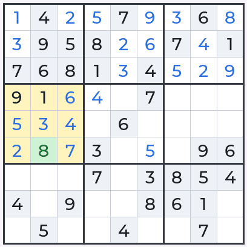

<!-- Written by tools/walkthrough.py disjoint-groups: edit the script, not this page. -->
# Disjoint Groups, step 23: the 8 in box 4

**Step 23 of 48** · [← Step 22](step-22.md) · [All steps](../disjoint-groups.md#the-whole-puzzle-step-by-step) · [Step 24 →](step-24.md)

Box 4 needs an 8, and r6c2 is its last empty cell: **r6c2 = 8**.

**Step 23 of 48** · [← Step 22](step-22.md) · [All steps](../disjoint-groups.md#the-whole-puzzle-step-by-step) · [Step 24 →](step-24.md)
