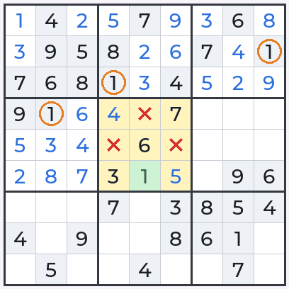

<!-- Written by tools/walkthrough.py disjoint-groups: edit the script, not this page. -->
# Disjoint Groups, step 24: the 1 in box 5

**Step 24 of 48** · [← Step 23](step-23.md) · [All steps](../disjoint-groups.md#the-whole-puzzle-step-by-step) · [Step 25 →](step-25.md)

Box 5 needs a 1. r4c5: row 4 has one (r4c2). r5c4: column 4 has one (r3c4). r5c6: the right group has one (r2c9). Only **r6c5** is left: **r6c5 = 1**.

**Step 24 of 48** · [← Step 23](step-23.md) · [All steps](../disjoint-groups.md#the-whole-puzzle-step-by-step) · [Step 25 →](step-25.md)
