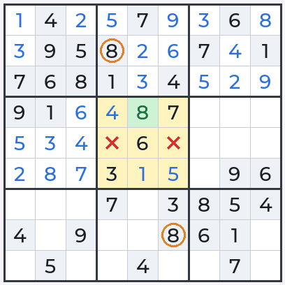

<!-- Written by tools/walkthrough.py disjoint-groups: edit the script, not this page. -->
# Disjoint Groups, step 25: the 8 in box 5

**Step 25 of 48** · [← Step 24](step-24.md) · [All steps](../disjoint-groups.md#the-whole-puzzle-step-by-step) · [Step 26 →](step-26.md)

Box 5 needs an 8. r5c4: column 4 has one (r2c4). r5c6: column 6 has one (r8c6). Only **r4c5** is left: **r4c5 = 8**.

**Step 25 of 48** · [← Step 24](step-24.md) · [All steps](../disjoint-groups.md#the-whole-puzzle-step-by-step) · [Step 26 →](step-26.md)
