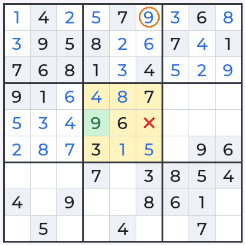

<!-- Written by tools/walkthrough.py disjoint-groups: edit the script, not this page. -->
# Disjoint Groups, step 26: the 9 in box 5

**Step 26 of 48** · [← Step 25](step-25.md) · [All steps](../disjoint-groups.md#the-whole-puzzle-step-by-step) · [Step 27 →](step-27.md)

Box 5 needs a 9. r5c6: column 6 has one (r1c6). Only **r5c4** is left: **r5c4 = 9**.

**Step 26 of 48** · [← Step 25](step-25.md) · [All steps](../disjoint-groups.md#the-whole-puzzle-step-by-step) · [Step 27 →](step-27.md)
