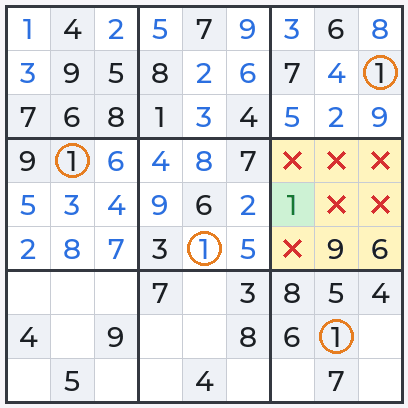

<!-- Written by tools/walkthrough.py disjoint-groups: edit the script, not this page. -->
# Disjoint Groups, step 28: the 1 in box 6

**Step 28 of 48** · [← Step 27](step-27.md) · [All steps](../disjoint-groups.md#the-whole-puzzle-step-by-step) · [Step 29 →](step-29.md)

Box 6 needs a 1. r4c7, r4c8 and r4c9: row 4 has one (r4c2). r5c8: column 8 has one (r8c8). r5c9: column 9 has one (r2c9). r6c7: row 6 has one (r6c5). Only **r5c7** is left: **r5c7 = 1**.

**Step 28 of 48** · [← Step 27](step-27.md) · [All steps](../disjoint-groups.md#the-whole-puzzle-step-by-step) · [Step 29 →](step-29.md)
