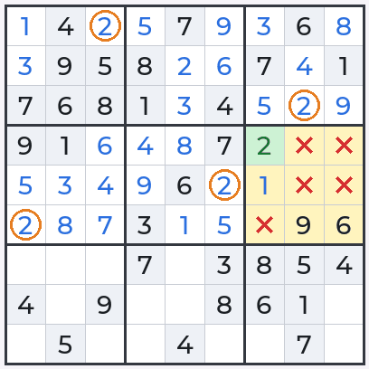

<!-- Written by tools/walkthrough.py disjoint-groups: edit the script, not this page. -->
# Disjoint Groups, step 29: the 2 in box 6

**Step 29 of 48** · [← Step 28](step-28.md) · [All steps](../disjoint-groups.md#the-whole-puzzle-step-by-step) · [Step 30 →](step-30.md)

Box 6 needs a 2. r4c8: column 8 has one (r3c8). r4c9: the top-right group has one (r1c3). r5c8 and r5c9: row 5 has one (r5c6). r6c7: row 6 has one (r6c1). Only **r4c7** is left: **r4c7 = 2**.

**Step 29 of 48** · [← Step 28](step-28.md) · [All steps](../disjoint-groups.md#the-whole-puzzle-step-by-step) · [Step 30 →](step-30.md)
