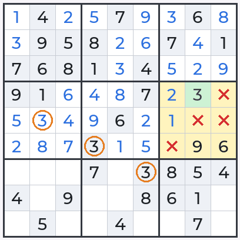

<!-- Written by tools/walkthrough.py disjoint-groups: edit the script, not this page. -->
# Disjoint Groups, step 30: the 3 in box 6

**Step 30 of 48** · [← Step 29](step-29.md) · [All steps](../disjoint-groups.md#the-whole-puzzle-step-by-step) · [Step 31 →](step-31.md)

Box 6 needs a 3. r4c9: the top-right group has one (r7c6). r5c8 and r5c9: row 5 has one (r5c2). r6c7: row 6 has one (r6c4). Only **r4c8** is left: **r4c8 = 3**.

**Step 30 of 48** · [← Step 29](step-29.md) · [All steps](../disjoint-groups.md#the-whole-puzzle-step-by-step) · [Step 31 →](step-31.md)
