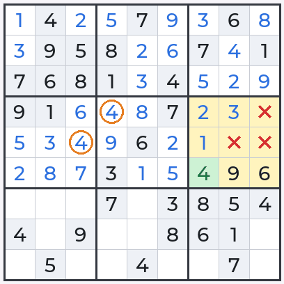

<!-- Written by tools/walkthrough.py disjoint-groups: edit the script, not this page. -->
# Disjoint Groups, step 31: the 4 in box 6

**Step 31 of 48** · [← Step 30](step-30.md) · [All steps](../disjoint-groups.md#the-whole-puzzle-step-by-step) · [Step 32 →](step-32.md)

Box 6 needs a 4. r4c9: row 4 has one (r4c4). r5c8 and r5c9: row 5 has one (r5c3). Only **r6c7** is left: **r6c7 = 4**.

**Step 31 of 48** · [← Step 30](step-30.md) · [All steps](../disjoint-groups.md#the-whole-puzzle-step-by-step) · [Step 32 →](step-32.md)
