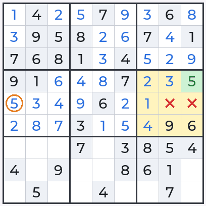

<!-- Written by tools/walkthrough.py disjoint-groups: edit the script, not this page. -->
# Disjoint Groups, step 32: the 5 in box 6

**Step 32 of 48** · [← Step 31](step-31.md) · [All steps](../disjoint-groups.md#the-whole-puzzle-step-by-step) · [Step 33 →](step-33.md)

Box 6 needs a 5. r5c8 and r5c9: row 5 has one (r5c1). Only **r4c9** is left: **r4c9 = 5**.

**Step 32 of 48** · [← Step 31](step-31.md) · [All steps](../disjoint-groups.md#the-whole-puzzle-step-by-step) · [Step 33 →](step-33.md)
