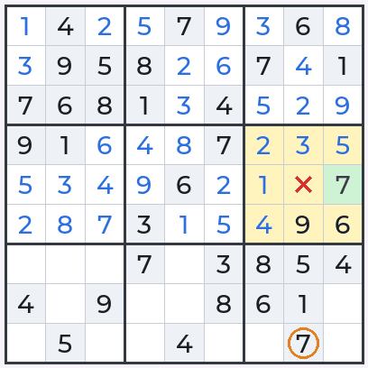

<!-- Written by tools/walkthrough.py disjoint-groups: edit the script, not this page. -->
# Disjoint Groups, step 33: the 7 in box 6

**Step 33 of 48** · [← Step 32](step-32.md) · [All steps](../disjoint-groups.md#the-whole-puzzle-step-by-step) · [Step 34 →](step-34.md)

Box 6 needs a 7. r5c8: column 8 has one (r9c8). Only **r5c9** is left: **r5c9 = 7**.

**Step 33 of 48** · [← Step 32](step-32.md) · [All steps](../disjoint-groups.md#the-whole-puzzle-step-by-step) · [Step 34 →](step-34.md)
