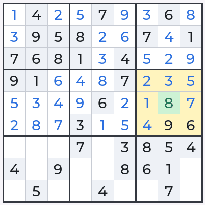

<!-- Written by tools/walkthrough.py disjoint-groups: edit the script, not this page. -->
# Disjoint Groups, step 34: the 8 in box 6

**Step 34 of 48** · [← Step 33](step-33.md) · [All steps](../disjoint-groups.md#the-whole-puzzle-step-by-step) · [Step 35 →](step-35.md)

Box 6 needs an 8, and r5c8 is its last empty cell: **r5c8 = 8**.

**Step 34 of 48** · [← Step 33](step-33.md) · [All steps](../disjoint-groups.md#the-whole-puzzle-step-by-step) · [Step 35 →](step-35.md)
